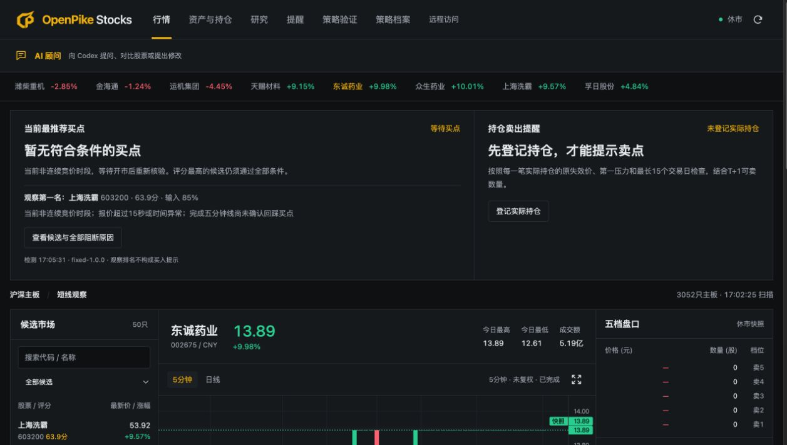
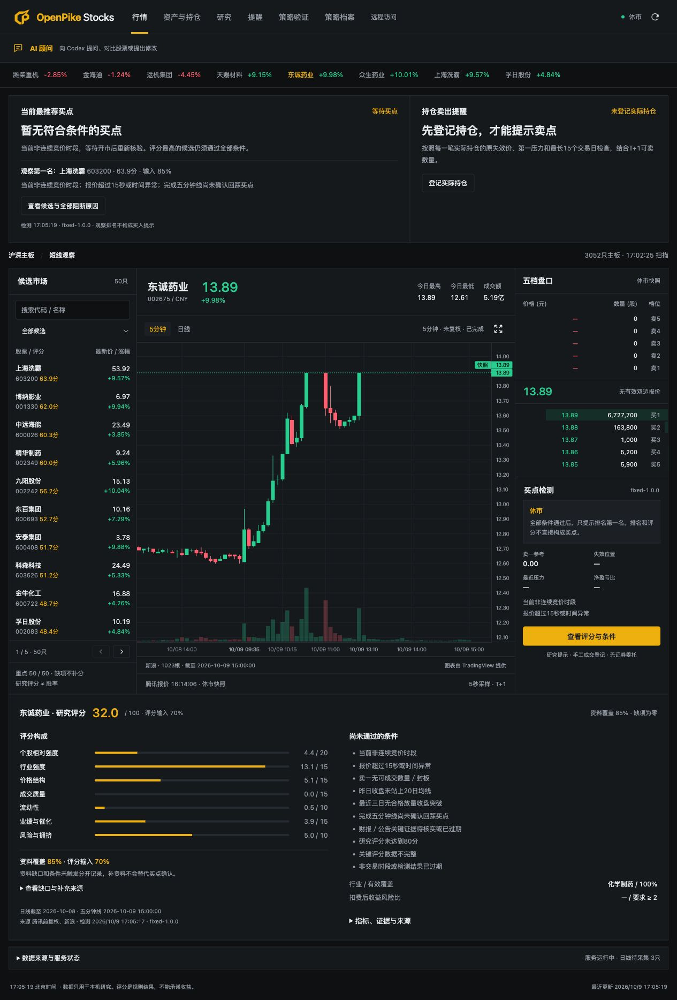
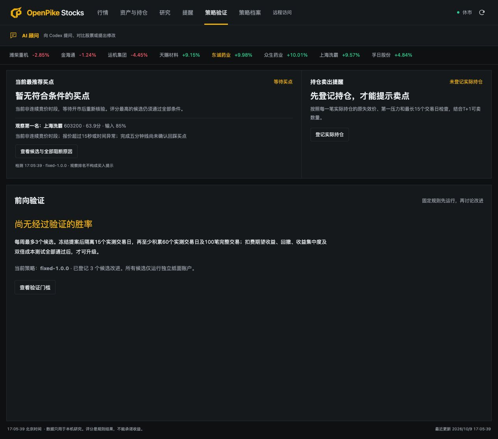

<p align="center"></p>

# OpenPike Stocks

**把买点条件、退出边界和判断依据，放进同一个看板。**

OpenPike Stocks 为想把交易观察变成固定流程的 A 股研究者而做：自动检查买点条件，按已登记持仓提示退出条件，每一次等待和判断都有依据。

Local-first A-share research dashboard with rule-based entry checks, holding exit alerts, paper tracking, and auditable strategy snapshots. No broker orders.

[](https://github.com/spikesubingrui-design/openpikestocks/actions/workflows/checks.yml)
[](LICENSE)



> 2026-10-09 本机真实运行截图，处于休市与等待状态；未登记个人实际持仓。截图中的股票与报价用于展示界面，不构成当前买入建议。公开源码预览没有公共体验站。

## 三个关键问题，一个工作台

| 你在判断什么 | 看板怎样帮助你 |
|---|---|
| 现在有没有满足规则的买点？ | 同时检查评分、确认线、关键证据与风控，条件不足明确等待 |
| 买入以后何时需要退出？ | 依据实际登记批次的失效价、第一压力、持有期限与 T+1 检查 |
| 为什么会给出这个判断？ | 展示评分构成、缺项与阻断原因，保存当时输入与规则版本 |

这是一套可解释的观察流程。更高分的候选仍可能不满足买点；资料不完整、报价过期或休市时，等待本身就是明确结果。

## 它能做什么

- **买点条件检查**：固定研究评分与硬条件共同判断；不合格就显示等待与阻断原因。
- **持仓退出提醒**：根据手工登记的实际买入批次，检查原失效价、第一压力、15 个交易日期限与 T+1。
- **行情与资料覆盖**：K 线、盘口、财务资料、公告证据及来源时间；缺失资料不编造、不补分。
- **纸面记录与真实登记分开**：纸面结果不能代替真实成交。
- **策略档案**：规则版本、输入快照、观察判断和退出记录可追溯。
- **Mac 独立窗口**：AppKit / WKWebView 源码，Apple Silicon、macOS 14+ 可自行构建。

评分 80 分不是 80% 胜率。本项目没有券商委托接口，也不承诺收益。免费公开行情接口可能延迟、限流或变更。实测提醒和成交效果需要使用者自行验证。

## 看得见的判断依据

<details>
<summary>展开完整行情、K 线、五档盘口与评分截图</summary>



</details>

## 策略改进，先过验证门槛



当前没有经过验证的胜率。候选改进需要隔离期、前向交易样本及成本、回撤和集中度检查；截图展示规则门槛，并非已达成的收益结果。

## 快速开始

需要 Python 3.12 和 uv。以下命令在仓库根目录执行：

```sh
git clone https://github.com/spikesubingrui-design/openpikestocks.git
cd openpikestocks
uv venv --python 3.12 .local/ashare/venv
uv pip sync --python .local/ashare/venv/bin/python --require-hashes ashare/requirements.lock
.local/ashare/venv/bin/python -m uvicorn ashare.app:app --host 127.0.0.1 --port 8765
```

打开 <http://127.0.0.1:8765>。首次启动需要采集资料；没有完整输入时等待属于正常行为。需要更新公告风险和催化的人工核查，才能满足所有买点条件。

macOS 用户可选自动启动服务和原生窗口：

```sh
.local/ashare/venv/bin/python -m ashare.service install
.local/ashare/venv/bin/python ashare/desktop/build_app.py --install
```

构建需要 Apple Swift 工具链；客户端依赖此仓库和本机环境，尚未提供经过公证、可独立安装的发行包。已存在的其他工程同名服务或端口会被拒绝替换。

## 验证

```sh
.local/ashare/venv/bin/python -m pytest ashare/tests -q
node ashare/tests/test_action_ui.cjs
```

自动化测试覆盖评分与缺项阻断、T+1、旧报价、未完成 K 线、事件租约、退出提示和访问权限。测试通过不等于公开行情稳定性、真实收益或每个安装环境验收通过。

## 范围与文档

面向沪深主板的研究条件，完整评分最多覆盖 50 只重点股票；全市场候选发现不等于逐只完整评分。当前交易日历限 2026 年，未知年份阻断新买，下一年度需更新。

- [规则、数据与 API](ashare/README.md)
- [Mac 客户端](ashare/desktop/README.md)
- [可选远程代码说明](ashare/REMOTE_ACCESS.md)：示例域名，未提供公共体验服务
- [发布记录](CHANGELOG.md)
- [参与贡献](CONTRIBUTING.md)
- [产品介绍与 60 秒视频脚本](docs/LAUNCH.md)

AI 顾问属于可选本机集成，需配置可用的 Codex 环境；普通源码安装不保证聊天接入可用。

数据存于本机 `.local/ashare/`，仓库不含个人持仓、数据库、密码、云服务器配置或期货研究资料。MIT 适用于本仓库原创源码；第三方图表库保留原许可证与 NOTICE。
